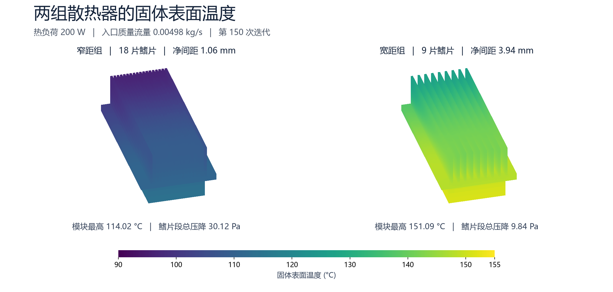

# 200 W 等效热源下的风冷散热器对比

在相同风道、200 W 热负荷及 0.00498 kg/s 入口质量流量下，对比 18 片窄距和 9 片宽距鳍片。首轮试算中，窄距组的热模块最高温度比宽距组低 37.08 °C，鳍片段总压降高 20.28 Pa。随后对窄距组做一次局部加密和数值滤波对照，检验这些指标对网格和数值设置的敏感程度。

## 模型与工况

| 条件 | 设定 |
| --- | --- |
| 散热器底板 | 两组均为 120 × 60 × 5 mm |
| 鳍片尺寸 | 流向长 120 mm，高 25 mm，厚 1.5 mm |
| 等效发热模块 | 107.5 × 45 × 17 mm，均匀体积发热约 2.432 MW/m³，总功率 200 W |
| 空气域 | 入口延长段 10 mm，鳍片段 120 mm，出口延长段 10 mm |
| 入口与出口 | 入口质量流量 0.00498 kg/s，入口总温 298.15 K。出口静表压 0 Pa，回流总温 298.15 K |
| 求解设置 | Ansys Fluent 2026 R1 Student，稳态层流计算并求解能量方程。流固界面及模块与底板接触面采用耦合传热，外壁绝热 |

热模块最高温度取发热固体区内的最高单元静温。鳍片段总压降取 X = 0 mm 与 X = 120 mm 两个内部截面的质量加权总压之差。模型中的温度对应统一的等效发热模块。

## 宽窄距首轮对比

| 方案 | 鳍片数 | 净间距（mm） | 体网格单元数 | 热模块最高温度（°C） | 鳍片段总压降（Pa） |
| --- | ---: | ---: | ---: | ---: | ---: |
| 窄距 | 18 | 1.0588 | 141,492 | 114.02 | 30.12 |
| 宽距 | 9 | 3.9375 | 601,786 | 151.09 | 9.84 |

图中使用两组首轮第 150 步的固体面温度，视角、比例和色标一致。首轮窄距和宽距两组的空气净带走热量分别为 200.00 W 和 200.18 W。

## 窄距组的局部网格敏感性

对首轮窄距网格中紧贴中段流固界面的第一层空气单元加密。体网格由 141,492 增至 194,892 单元，加密后最低正交质量为 0.01557，Fluent 网格检查正常完成。两次试算在同一个加密起点上分别续算 100 步。

| 加密网格试算 | 热模块最高温度（°C） | 散热器固体最低温度（°C） | 鳍片段总压降（Pa） |
| --- | ---: | ---: | ---: |
| 未开启滤波，第 250 步 | 108.09 | 6.10 | 47.21 |
| 开启滤波，第 250 步 | 107.32 | 84.76 | 47.25 |
| 开启滤波，第 300 步 | 107.32 | 84.74 | 47.25 |

未滤波时，能量残差在末段持续回升，并出现两个低于进风温度的相邻固体单元。开启滤波后，这两个单元均回到 100 °C 以上，末段缩放能量残差在约 2.9 × 10⁻⁶ 附近波动。滤波试算第 250 步的空气净带走 200.03 W，进出口质量流量不平衡约 0.00175%。

## 结论与适用范围

- 在所设热负荷与进风条件下，首轮窄距方案的模块温度更低，鳍片段流动阻力更高。
- 窄距组做了近壁局部加密，并启用能量方程数值噪声滤波后，模块最高温度比首轮低约 6.7 °C，鳍片段总压降由 30.12 Pa 升至 47.25 Pa，升高 17.13 Pa。第 281–300 步，最高温度的最大值减最小值为 0.0021 °C。0.0012 Pa 是总压降在末段的波动幅度，总压降本身是 47.25 Pa。第 300 步空气净带走 199.99 W，与 200 W 热源相差 0.01 W，这是能量不平衡。进出口质量流量不平衡为 0.00013%，这是质量流量不平衡。两项检查分开对应能量守恒和质量守恒。末段波动很小，说明在这套网格上，模块最高温度和鳍片段总压降这两个指标已趋于稳定。要验证网格无关性，还需要在相同数值设置下比较系统加密后的网格结果。
- 当前采用层流假设。由三处截面估算的鳍片缝隙雷诺数，窄距组约 402–624，宽距组约 1,500–1,635。这些估算涵盖缝隙内的流动，对进出口发展区及旁通通道的流态仍有限制。

## 数据与结果复核

- [三组算例结果汇总](data/case_summary.csv) · [第二版迭代记录](data/dense_v2_iterations_250_300.csv)
- [核对脚本](analysis/verify_results.py) · [数据口径与 Fluent 复核说明](docs/reproduction.md)
